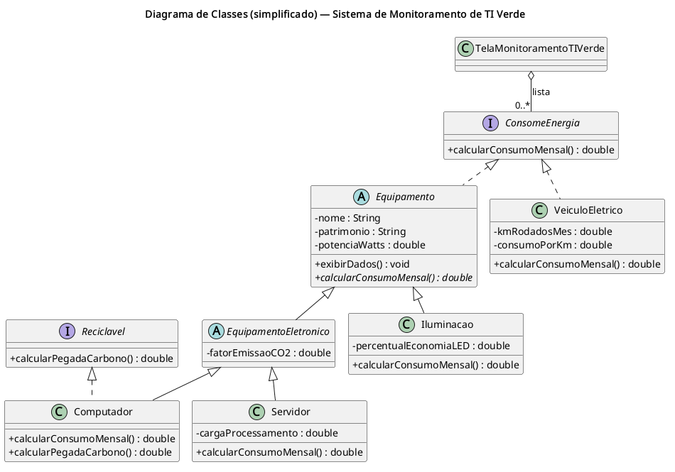

# ProjectGreenIT — Monitoramento de TI Verde

> Aplicação desktop em Java para cadastrar equipamentos e estimar o consumo mensal de energia e a pegada de carbono associada.

## Sobre o projeto

O **ProjectGreenIT** demonstra conceitos de programação orientada a objetos em um sistema de monitoramento de TI verde. Pela interface gráfica, é possível cadastrar computadores, servidores, pontos de iluminação e veículos elétricos, visualizar o consumo estimado de cada item e calcular os totais.

As estimativas são calculadas com parâmetros informados pelo usuário e premissas fixas no código. O projeto não coleta telemetria de equipamentos; os dados cadastrados permanecem em memória e são perdidos ao fechar a aplicação.

## Funcionalidades

- Cadastro de computadores, servidores, iluminação e veículos elétricos.
- Validação dos campos numéricos na interface, incluindo limites para carga de processamento e economia de LED.
- Exibição dos itens cadastrados e de seu consumo mensal estimado em kWh.
- Cálculo do consumo total mensal dos itens cadastrados.
- Estimativa de pegada de carbono para os tipos que implementam `Reciclavel`.
- Demonstração dos modelos e dos cálculos pela classe `TesteModelo`.

## Modelos e cálculos

| Tipo | Estimativa de consumo mensal |
| --- | --- |
| Computador | `potência (W) × 8 h/dia × 22 dias / 1.000` |
| Servidor | Consumo base de `potência (W) × 24 h/dia × 30 dias / 1.000`, acrescido de até 5% proporcional à carga de processamento. |
| Iluminação | `potência (W) × 8 h/dia × 30 dias / 1.000`, reduzido pela fração de economia LED. Por exemplo, `0,30` representa 30%. |
| Veículo elétrico | `quilômetros rodados no mês × consumo em kWh/km` |

O computador calcula também a pegada de carbono multiplicando seu consumo mensal pelo fator de emissão configurado (inicialmente `0,5 kg CO₂/kWh`). O total apresentado pela interface soma os resultados dos itens que implementam `Reciclavel`; atualmente, essa interface é implementada por `Computador`.

## Tecnologias e requisitos

- Java JDK 25 (versão-alvo configurada no projeto Eclipse).
- Java Swing (`java.desktop`) para a interface gráfica.
- Nenhuma dependência externa.

## Compilar e executar

Execute os comandos a partir da raiz do repositório, com o JDK 25 instalado:

```bash
javac -d bin src/module-info.java src/model/*.java src/view/*.java src/test/*.java
```

Para abrir a aplicação gráfica:

```bash
java --module-path bin --module ProjectGreenIT/view.TelaMonitoramentoTiVerde
```

Para executar a demonstração dos modelos no terminal:

```bash
java --module-path bin --module ProjectGreenIT/test.TesteModelo
```

A demonstração imprime os valores calculados para exemplos de cada tipo, incluindo um consumo total esperado próximo de `557,28 kWh` e uma pegada calculada próxima de `13,2 kg CO₂`.

## Estrutura do projeto

```text
ProjectGreenIT/
├── docs/               # Diagramas de classes em PlantUML e imagens
├── src/
│   ├── model/           # Equipamentos, interfaces e regras de cálculo
│   ├── test/            # Demonstração executável dos modelos
│   ├── view/            # Interface gráfica Swing
│   └── module-info.java # Declaração do módulo Java
├── .settings/           # Preferências do projeto Eclipse
├── .classpath           # Caminhos de compilação do Eclipse
└── .project             # Metadados do projeto Eclipse
```

## Diagramas

O diretório [`docs/`](docs/) contém os diagramas editáveis em PlantUML (`.puml`) e suas imagens exportadas.



- [Diagrama simplificado (PlantUML)](docs/DiagramaClassesSimples.puml)
- [Diagrama completo (PNG)](docs/DiagramaClasses.png)
- [Diagrama completo (PlantUML)](docs/DiagramaClasses.puml)
